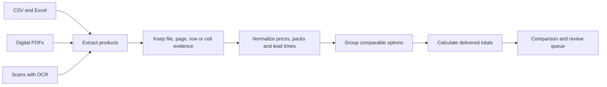

# Supplier Catalog Intelligence

A source-linked comparison workflow for interior products. It reads CSV cells, Excel cells, and text from digital PDFs. Scanned images can be read with optional Tesseract OCR. See [PROPOSAL.md](PROPOSAL.md) for the wider plan.



### What the team sees

| Option | Unit price | Shipping | Delivered total for 4 | Review |
| --- | ---: | ---: | ---: | --- |
| Supplier A · A-00 | £90 | £15 | **£375** | Ready |
| Supplier B · B-00 | £94 | £15 | £391 | Ready |
| Supplier C · C-00 | £98 | Unknown | **Unknown** | Check delivery fee |

These are invented demo rows. The report links each input value back to its source location. It never treats a missing delivery fee as free shipping.

## Try it

```powershell
python -m pip install -e .
python scripts/make_demo.py
catalog-intel demo/config.json -o demo/output
```

The invented demo has 36 chairs from three suppliers. Open `demo/output/comparison.xlsx` or `comparison.csv`, then check `summary.md`, `review_queue.csv`, `manifest.json`, `assumptions.json`, and `ingestion_errors.json`. Missing shipping stays unknown, so those rows have no delivered total. Every populated input field has a file and cell, row, or page reference in the `evidence` column.

## Use your own files

Copy `demo/config.json` as a template. Paths are relative to the config file. Set each supplier and file's access and reuse terms. Put your quantity, target currency, conversion rates, rate date, and tax assumption in `comparison`. Rates mean one unit of source currency in target currency. Record real rates and dates yourself; the app does not fetch live rates. Private quotes should stay outside this repository.

CSV and XLSX files should have a header row. Useful columns are `sku`, `name`, `category`, `material`, `finish`, `dimensions`, `variant`, `pack_size`, `currency`, `unit_price`, `moq`, `availability`, `delivery_charge`, `delivery_condition`, `lead_time_days`, and `image`. Price is per pack; `pack_size` is units per pack. Shipping is per order. Delivery charge `0` means explicitly free; blank means unknown. Lead time is days or a range such as `5-8`.

Digital PDF rows currently need this form on one text line:

```text
PRODUCT | sku=ABC-1 | name=Oak chair | category=dining chair | material=oak | finish=natural | dimensions=48x52x78 cm | variant=standard | pack_size=1 | currency=GBP | unit_price=120 | moq=1 | delivery_charge=20 | lead_time_days=5-8
```

For image OCR, install `pip install -e .[ocr]` and the Tesseract executable. OCR errors are reported in `ingestion_errors.json`. OCR text still needs the labelled row format. This is an explicit baseline, not a general visual catalogue model. Product images are retained as references when provided, but are not matched automatically. Matching requires exact category, material, finish, dimensions, variant, and pack size; a shared group is a comparison suggestion. Output includes review flags for missing facts. There is no live supplier data or claimed model benchmark yet.

## Checks

```powershell
python -m pip install -e .[test]
python -m pytest
```

This independent portfolio project is not affiliated with the clients who inspired the proposal. External source terms remain with their owners.
